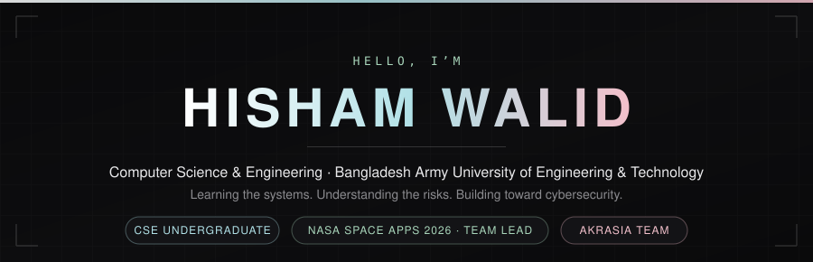

<!--
  ============================================================
  Profile README for github.com/Hishamwalid
  ------------------------------------------------------------
  Stats card (./profile/streak.svg) regenerates automatically
  via .github/workflows/streak-stats.yml every day at 03:17 UTC.

  Commit ratios below were measured on 2026-10-18 and only
  drift slowly as more commits land. Everything else here is
  either auto-generated or a stable fact.
  ============================================================
-->

  

  

  
  
  
  

  
  

---

## 👋 Hi, I'm Hisham Walid

I'm a Computer Science & Engineering undergraduate at **Bangladesh Army University of Engineering & Technology (BAUET)**. I lead a team competing in the **2026 NASA Space Apps Challenge**, and I'm moving into cybersecurity — starting from the foundations: Linux, computer networks, and operating systems.

What I care about is software that actually ships. The projects below are ones I led or contributed real code to, whether that's a game people can play, an app other students use every week, or a team running under a challenge deadline.

I'm currently strengthening my Linux administration, networking and systems fundamentals, and I plan to pursue postgraduate study in cybersecurity.

---

## 📊 Stats

  

  
  

> **Total Contributions** on the card above includes work in private repositories — it's generated inside this repo by a GitHub Actions workflow using my own token, and it refreshes itself daily.
>
> The commits row is deliberately hidden from the stats card. Public commit-count badges are built on GitHub's public event feed, so they can't see private repos and report a number well below my actual total. I'd rather show no commit count there than a misleading one — the accurate figure is on the card above.

---

## 🚀 Featured Work

### 🚀 Mars Horizon — Junior Astronaut Mission Trainer

**Team Lead · [NASA Space Apps Challenge 2026](https://www.spaceappschallenge.org/)** · [Repository](https://github.com/Theteamakrasia/Mars-Horizon-Junior-Astronaut-Mission-Trainer)

A space-survival strategy game for ages ~8–16, where you run a Martian research outpost. There are no enemies — the hardest thing you fight is a resource budget. You balance power, oxygen, water, food and morale, making the same kinds of trade-offs real NASA engineers face every day, built on real NASA open data.

- **Stack:** TypeScript 5.9 · Vite 7.3 · Vitest 3.2
- **Engineering:** CI on every push, automated Vercel deploys, MIT licensed
- **My contribution:** 39 of 65 commits — team lead

---

### 📄 BAUET Cover Generator

**AKRASIA team** · [Live app](https://cover-lagbe.teamtheakrasia.workers.dev)

A web app that generates print-ready, correctly formatted cover pages for BAUET assignment and lab reports. Fill the form once, get an A4 PDF matched to your department's official style — instead of rebuilding the same cover by hand every single submission.

- **Stack:** Next.js 14 (App Router) · TypeScript · Tailwind CSS · Zod
- **PDF export:** SnapDOM + jsPDF, rendered client-side — no server-side Chromium
- **Storage:** flat files (JSON / CSV / HTML), no database, no CMS — content updates are just a git commit
- **Hosted on:** Cloudflare Pages

---

### 🌾 Forecast Farm

**CSE-3108 Web Programming group project** · [Repository](https://github.com/Shabab47/CSE-3108-WebProgramming-Group-Project-Forecast-Farm)

A 2D browser farming game driven by the **real weather at the player's own location**. Rain genuinely waters the crops, heat dries them out, frost wounds them — all of it from a live forecast rather than invented numbers. Crops grow in real time, so a six-hour crop takes six hours whether or not the game is open.

- **Stack:** Vanilla JavaScript · `node:test` · hand-rolled dev server and import checker
- **My contribution:** 88 of 182 commits

---

### ☕ EmergencyShake

**My first Java project** · [Repository](https://github.com/Hishamwalid/EmergencyShake)

Built with two teammates — the first time I worked in a small team and had to write code other people had to read. It earned **⭐ 3** and is still the repo I'm most attached to, because it's where I learned that writing for other developers is a different skill entirely.

- **Stack:** Java · 3-person team
- **My contribution:** 63 of 131 commits

---

## 📂 All Projects

### Personal repositories

| Project | What it is | Stack | My commits |
|---|---|---|---|
| [EmergencyShake](https://github.com/Hishamwalid/EmergencyShake) ⭐ | First Java project, 3-person team | Java | 63 / 131 |
| [Hollow_beneath](https://github.com/Hishamwalid/Hollow_beneath) | 2D narrative board game | TypeScript | 30 / 64 |
| [CSE-3108](https://github.com/Hishamwalid/CSE-3108) | Web Programming lab tasks · [live](https://hishamwalid.github.io/CSE-3108/) | JavaScript, CSS | 7 / 7 |
| [Faculty-evaluation](https://github.com/Hishamwalid/Faculty-evaluation) | Playwright bot automating the BAUET iEMS portal | Python | 5 / 5 |
| [Data-Structures-Algorithms](https://github.com/Hishamwalid/Data-Structures-Algorithms) | Algorithms written up the way I understood them | HTML | 13 / 13 |

### Team projects

| Project | What it is | Stack | My commits | Link |
|---|---|---|---|---|
| Mars Horizon | NASA Space Apps 2026 entry — **Team Lead** | TypeScript, Vite | 39 / 65 | [Repo](https://github.com/Theteamakrasia/Mars-Horizon-Junior-Astronaut-Mission-Trainer) |
| BAUET Cover Generator | Print-ready BAUET cover pages | Next.js, Tailwind | — | [Live app](https://cover-lagbe.teamtheakrasia.workers.dev) |
| Forecast Farm | Real-weather farming game | Vanilla JS | 88 / 182 | [Repo](https://github.com/Shabab47/CSE-3108-WebProgramming-Group-Project-Forecast-Farm) |

---

## 🌱 What I'm learning right now

- **Linux administration** — command line, permissions, users, services
- **Computer networking** — how traffic actually moves, and how it's abused
- **Operating systems** — processes, memory, what happens under the shell
- **Security fundamentals** — threat modelling, secure defaults, reading code for risk

The long term: postgraduate study in cybersecurity, and practical work where I can use these foundations for something real.

---

## 🛠 Tech Stack

**Shipped** — everything here is backed by commits you can click:

`TypeScript` `JavaScript` `Java` `Python` `HTML` `CSS` `Next.js` `Tailwind CSS` `Vite` `Vitest` `Zod` `Git` `GitHub Actions` `Cloudflare Pages` `Vercel`

**Learning** — no repos behind these yet, so I'm not claiming them as skills:

`C` `C++` `SQL` `Bash` `Linux administration` `Networking`

---

## 🏆 Highlights

- 🛰️ **Team Lead** — NASA Space Apps Challenge 2026 (Nov 14–15, 2026)
- 🚀 **60%** of the Mars Horizon codebase
- 🌾 **48%** of the Forecast Farm codebase
- 📄 Shipped a production web app that BAUET students actually use
- 🤝 **17 pull requests** opened, and contributions to 4 repositories I don't own
- 🏅 **GitHub Pair Extraordinaire ×2** — for co-authored commits
- 👥 Part of the **AKRASIA** team
- 🧱 8 projects across 5 personal repositories and 3 team repositories

---

## 📬 Let's connect

<!-- TODO: replace these with your real links -->

  
  
  

---

  

